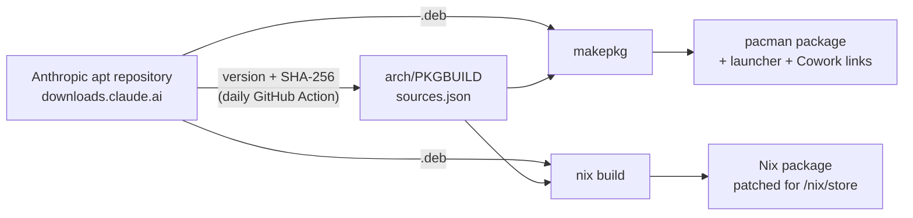

<div align="center">

# Claude Desktop for Arch Linux, CachyOS & NixOS

**The official Claude desktop app with Chat, Cowork and Claude Code, packaged for distributions Anthropic doesn't ship to yet.**

[](https://github.com/d1rtym0lly/claude-desktop-linux/actions/workflows/build.yml)
[](sources.json)


**English** · [Русский](README.ru.md)

</div>

---

Anthropic publishes the Linux desktop app (beta) only as a `.deb` for Ubuntu and Debian. This repository turns that exact `.deb` into a native package for your system. The app itself is not changed; the package only adds what Arch, CachyOS and NixOS need to run it properly.

> [!NOTE]
> This is an **unofficial** community project and is not affiliated with Anthropic. Claude Desktop is proprietary, so it is **not** stored in this repository: it is downloaded from Anthropic's own server (`downloads.claude.ai`) while you build, and its SHA-256 checksum is verified. AUR packages work the same way.

## Contents

- [Quick start](#quick-start)
- [What you get](#what-you-get)
- [Step-by-step: Arch Linux / CachyOS](#step-by-step-arch-linux--cachyos)
- [NixOS](#nixos)
- [Cowork setup](#cowork-setup)
- [Faster start and settings](#faster-start-and-settings)
- [Updating and removing](#updating-and-removing)
- [Troubleshooting](#troubleshooting)
- [How it works](#how-it-works)
- [FAQ](#faq)

## Quick start

**Arch Linux, CachyOS, EndeavourOS, Manjaro:**

```bash
sudo pacman -S --needed git base-devel
git clone https://github.com/d1rtym0lly/claude-desktop-linux.git
cd claude-desktop-linux/arch && makepkg -si
```

**NixOS:** try it without installing:

```bash
nix run github:d1rtym0lly/claude-desktop-linux
```

To install it for good, see [NixOS](#nixos).

Then open **Claude** from your app menu and sign in.

## What you get

| | |
|---|---|
| 🖥️ **The real app** | Anthropic's own build, the same one Ubuntu users get: Chat, Cowork, Claude Code, parallel sessions, diff review, terminal |
| 🔑 **Sign-in that sticks** | On Hyprland, Sway, niri, i3 and similar, plain Electron forgets your login on every start. The launcher points it at your keyring. |
| 🪟 **Native Wayland** | Sharp text with fractional scaling, no XWayland |
| ⚡ **Instant open** | Optional autostart: the app is already running, so opening it just shows the window |
| 🧪 **Cowork works** | Links QEMU, UEFI firmware and virtiofsd to the paths the app expects (it only knows Debian's) |
| 🔄 **Always current** | A daily GitHub Action checks Anthropic's repository and updates the version and checksums |
| ✅ **Tested on every change** | CI builds and installs the Arch package, checks every shared library, launches the app, and builds the Nix package |

## Step-by-step: Arch Linux / CachyOS

<details open>
<summary><b>1. Install the build tools</b></summary>

```bash
sudo pacman -S --needed git base-devel
```

`git` downloads this repository, and `base-devel` provides `makepkg`, the standard Arch tool for building packages.
</details>

<details open>
<summary><b>2. Download this repository</b></summary>

```bash
git clone https://github.com/d1rtym0lly/claude-desktop-linux.git
cd claude-desktop-linux/arch
```
</details>

<details open>
<summary><b>3. Build and install</b></summary>

```bash
makepkg -si
```

What happens: `makepkg` downloads the official `.deb` (~160 MB), checks its checksum, builds a `claude-desktop` package and asks for your password to install it and its dependencies with pacman.

If you already installed Claude Desktop by hand (with `debtap` or your own PKGBUILD), the new package simply replaces it.
</details>

<details open>
<summary><b>4. Sign in so it stays signed in</b></summary>

The app stores your login in the system keyring. KDE Plasma (KWallet) and GNOME (GNOME Keyring) already have one. On any other desktop install one:

```bash
sudo pacman -S gnome-keyring
```

Then start **Claude** from the app menu (or run `claude-desktop`) and sign in with your Claude account.
</details>

## NixOS

Add the flake to your system configuration:

```nix
# flake.nix
{
  inputs = {
    nixpkgs.url = "github:NixOS/nixpkgs/nixos-unstable";
    claude-desktop.url = "github:d1rtym0lly/claude-desktop-linux";
    claude-desktop.inputs.nixpkgs.follows = "nixpkgs";
  };

  outputs = { nixpkgs, claude-desktop, ... }: {
    nixosConfigurations.my-laptop = nixpkgs.lib.nixosSystem {
      system = "x86_64-linux";
      modules = [
        ./configuration.nix
        claude-desktop.nixosModules.default
        {
          programs.claude-desktop.enable = true;
          users.users.YOUR_USER.extraGroups = [ "kvm" ];  # for Cowork
        }
      ];
    };
  };
}
```

Then run `sudo nixos-rebuild switch`.

`programs.claude-desktop.enable` does the following:

- installs the app;
- turns on `gnome-keyring` so the sign-in is kept;
- turns on `nix-ld`, because Claude Code inside the app runs prebuilt Linux binaries;
- with `cowork.enable = true` (the default), installs QEMU, OVMF and virtiofsd, links them at `/usr/bin` and `/usr/share/OVMF` where Cowork looks for them, and loads `vhost_vsock`.

<details>
<summary>Other ways: profile install, overlay</summary>

```bash
# Any Linux with Nix
nix profile install github:d1rtym0lly/claude-desktop-linux
```

```nix
# Overlay: adds pkgs.claude-desktop built from *your* nixpkgs
nixpkgs.overlays = [ claude-desktop.overlays.default ];
nixpkgs.config.allowUnfreePredicate = p: lib.getName p == "claude-desktop";
```

Without the module, Cowork won't find QEMU (NixOS has no `/usr/bin`), and Claude Code needs `programs.nix-ld.enable = true;`.
</details>

## Cowork setup

Cowork runs tasks inside a small virtual machine. On NixOS the module above handles it. On Arch and CachyOS:

```bash
sudo pacman -S --needed qemu-base edk2-ovmf
sudo usermod -aG kvm $USER
echo vhost_vsock | sudo tee /etc/modules-load.d/vhost_vsock.conf
sudo modprobe vhost_vsock
```

Then **log out and back in** so the group change takes effect. Hardware virtualization (Intel VT-x / AMD-V) must be enabled in your BIOS/UEFI.

The package already provides the paths Cowork expects: `/usr/share/OVMF/OVMF_CODE_4M.fd` (linked to Arch's `edk2-ovmf` firmware) and `/usr/bin/virtiofsd` (the one shipped inside the app).

## Faster start and settings

```bash
claude-desktop-autostart on     # start at login (off / status)
```

Once Claude is running in the background, opening it from the menu is instant.

**Custom Electron/Chromium flags** go in `~/.config/claude-desktop-flags.conf`, one per line:

```
# lines starting with # are ignored
--disable-gpu
```

**Environment variables:**

| Variable | Effect |
|---|---|
| `CLAUDE_PASSWORD_STORE=kwallet6` | Force a keyring backend: `gnome-libsecret`, `kwallet5`, `kwallet6`, `basic` |
| `CLAUDE_NO_WAYLAND=1` | Run through XWayland (try this for NVIDIA glitches) |
| `CLAUDE_LAUNCHER_DEBUG=1` | Print the exact command the launcher runs |

## Updating and removing

**Arch / CachyOS:**

```bash
cd claude-desktop-linux && git pull && cd arch && makepkg -si   # update
sudo pacman -R claude-desktop                                    # remove
```

The repository is updated automatically when Anthropic releases a new version, so `git pull` always gets you the newest one.

**NixOS:** `nix flake update claude-desktop && sudo nixos-rebuild switch`.

## Troubleshooting

<details>
<summary><b>I have to sign in every time</b></summary>

You need a running keyring (Secret Service):

- **KDE:** install `kwallet`.
- **Anything else:** install `gnome-keyring`.
- **Hyprland / Sway / i3** don't start it for you. Add it to your config, e.g. for Hyprland: `exec-once = gnome-keyring-daemon --start --components=secrets`.

Check what the app receives: `CLAUDE_LAUNCHER_DEBUG=1 claude-desktop`.
</details>

<details>
<summary><b>Black window, flickering or glitches (often NVIDIA)</b></summary>

Try `CLAUDE_NO_WAYLAND=1 claude-desktop`. If that helps, make it permanent, or add `--disable-gpu` to `~/.config/claude-desktop-flags.conf`.
</details>

<details>
<summary><b>Cowork says it needs QEMU / KVM / virtualization</b></summary>

1. `ls /dev/kvm` should exist. If it doesn't, enable VT-x/AMD-V in BIOS.
2. `groups` should list `kvm`. If it doesn't, run `sudo usermod -aG kvm $USER` and log in again.
3. `lsmod | grep vhost_vsock` should print something. If it doesn't, run `sudo modprobe vhost_vsock`.
4. `ls -L /usr/share/OVMF/OVMF_CODE_4M.fd` should succeed. If it doesn't, install `edk2-ovmf`.
5. Restart the app after any change.
</details>

<details>
<summary><b>makepkg: "The .deb has no /usr/bin/claude-desktop"</b></summary>

Anthropic changed how the package is laid out. Please [open an issue](https://github.com/d1rtym0lly/claude-desktop-linux/issues).
</details>

<details>
<summary><b>makepkg: checksum validation failed</b></summary>

Anthropic probably released a new version a moment ago. Run `git pull` and try again; the automatic update usually lands within a day.
</details>

<details>
<summary><b>Claude Code inside the app doesn't start (NixOS)</b></summary>

Enable `programs.nix-ld.enable = true;` (the module does this by default).
</details>

## How it works



- **`scripts/update.sh`** reads Anthropic's `Packages` index, which lists the version and SHA-256 of each release, and writes them into `arch/PKGBUILD` and `sources.json`. GitHub Actions runs it daily and commits any change.
- **`arch/PKGBUILD`** unpacks the `.deb`, removes Debian-only files (apt source, signing key), adds the launcher and the Cowork links, and routes the app's menu entries through the launcher.
- **`nix/package.nix`** does the same for Nix. `autoPatchelfHook` points every binary at libraries in `/nix/store`, and libraries the app loads at runtime (GL, Vulkan, PipeWire, libsecret…) are added to `LD_LIBRARY_PATH`.
- **`common/claude-desktop-launcher.sh`** is installed as `claude-desktop`. It picks the keyring backend and Wayland flags for your session, reads your flags file, then starts Anthropic's binary unchanged.

<details>
<summary>Repository layout</summary>

```
arch/PKGBUILD                       Arch / CachyOS package
common/claude-desktop-launcher.sh   launcher (shared by Arch and Nix)
common/claude-desktop-autostart.sh  autostart on/off helper
nix/package.nix                     Nix package
nix/module.nix                      NixOS module (programs.claude-desktop)
flake.nix                           flake: packages, overlay, nixosModules
sources.json                        version, URLs and hashes for Nix
scripts/update.sh                   version updater
.github/workflows/build.yml         daily update + test builds
```
</details>

<details>
<summary>What is tested, and what isn't yet</summary>

On every change, CI:

- builds the Arch package from the real `.deb` in an `archlinux` container and installs it;
- checks every binary and native module with `ldd`, failing if any library is missing;
- launches the app under Xvfb and checks that it is still running after 30 s;
- checks that Cowork's QEMU, firmware and virtiofsd paths resolve;
- builds the Nix package (`autoPatchelf` fails on any missing library) and evaluates the flake.

Not tested by CI: real Cowork sessions (CI has no KVM), aarch64, and the NixOS module on real hardware.
</details>

## FAQ

**Is this official?** No. It's a community package of the official app. Anthropic officially supports Ubuntu 22.04+ and Debian 12+.

**Is it safe?** Every file of the app comes from `downloads.claude.ai` and is checked against the checksum Anthropic publishes. Everything this repository adds is short shell and Nix code you can read in a few minutes.

**Why isn't there a ready-made package to download?** Claude Desktop is proprietary, and redistributing it isn't allowed. Building it locally from Anthropic's download avoids that.

**What isn't in the Linux beta?** Computer Use and voice dictation. These are limits of Anthropic's Linux build, not of this package.

## License

The packaging scripts are [MIT](LICENSE). Claude Desktop itself is proprietary software by Anthropic, used under [Anthropic's terms](https://www.anthropic.com/legal).
