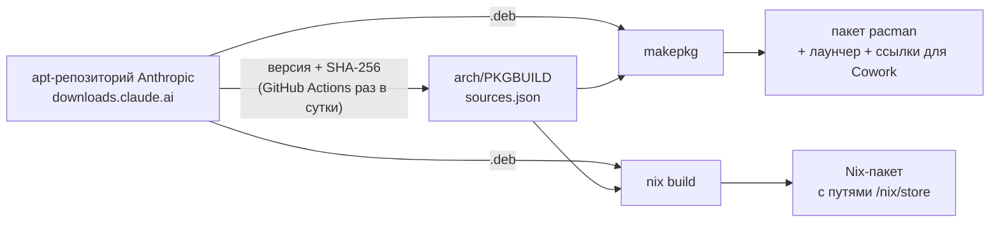

<div align="center">

# Claude Desktop для Arch Linux, CachyOS и NixOS

**Официальное десктоп-приложение Claude (Chat, Cowork и Claude Code) в виде пакета для дистрибутивов, под которые Anthropic его пока не выпускает.**

[](https://github.com/d1rtym0lly/claude-desktop-linux/actions/workflows/build.yml)
[](sources.json)


[English](README.md) · **Русский**

</div>

---

Anthropic выпускает Linux-версию приложения (бета) только как `.deb` для Ubuntu и Debian. Этот репозиторий превращает тот самый `.deb` в нативный пакет для твоей системы. Само приложение не меняется: пакет только добавляет то, что нужно для нормальной работы в Arch, CachyOS и NixOS.

> [!NOTE]
> Это **неофициальный** проект сообщества, он не связан с Anthropic. Claude Desktop — закрытое приложение, поэтому в репозитории его **нет**: оно скачивается с сервера Anthropic (`downloads.claude.ai`) во время сборки, и его контрольная сумма SHA-256 проверяется. Пакеты в AUR устроены так же.

## Содержание

- [Быстрый старт](#быстрый-старт)
- [Что ты получаешь](#что-ты-получаешь)
- [Пошагово: Arch Linux и CachyOS](#пошагово-arch-linux-и-cachyos)
- [NixOS](#nixos)
- [Настройка Cowork](#настройка-cowork)
- [Быстрый запуск и настройки](#быстрый-запуск-и-настройки)
- [Обновление и удаление](#обновление-и-удаление)
- [Решение проблем](#решение-проблем)
- [Как это работает](#как-это-работает)
- [Вопросы и ответы](#вопросы-и-ответы)

## Быстрый старт

**Arch Linux, CachyOS, EndeavourOS, Manjaro:**

```bash
sudo pacman -S --needed git base-devel
git clone https://github.com/d1rtym0lly/claude-desktop-linux.git
cd claude-desktop-linux/arch && makepkg -si
```

**NixOS:** попробовать без установки:

```bash
nix run github:d1rtym0lly/claude-desktop-linux
```

Как установить насовсем, описано в разделе [NixOS](#nixos).

Дальше открой **Claude** из меню приложений и войди в аккаунт.

## Что ты получаешь

| | |
|---|---|
| 🖥️ **Настоящее приложение** | Официальная сборка Anthropic, та же, что у пользователей Ubuntu: Chat, Cowork, Claude Code, параллельные сессии, просмотр изменений, терминал |
| 🔑 **Вход сохраняется** | В Hyprland, Sway, niri, i3 и подобных Electron без настройки забывает вход при каждом запуске. Лаунчер подключает его к хранилищу паролей. |
| 🪟 **Нативный Wayland** | Чёткий текст при дробном масштабировании, без XWayland |
| ⚡ **Мгновенное открытие** | Автозапуск по желанию: приложение уже работает в фоне, и открытие просто показывает окно |
| 🧪 **Cowork работает** | QEMU, прошивка UEFI и virtiofsd подключаются по путям, где их ищет приложение (оно знает только пути Debian) |
| 🔄 **Всегда свежая версия** | GitHub Actions каждый день проверяет репозиторий Anthropic и обновляет версию и контрольные суммы |
| ✅ **Проверка при каждом изменении** | CI собирает и устанавливает пакет для Arch, проверяет все библиотеки, запускает приложение и собирает Nix-пакет |

## Пошагово: Arch Linux и CachyOS

<details open>
<summary><b>1. Установи инструменты сборки</b></summary>

```bash
sudo pacman -S --needed git base-devel
```

`git` скачает этот репозиторий, а `base-devel` содержит `makepkg`, стандартный инструмент Arch для сборки пакетов.
</details>

<details open>
<summary><b>2. Скачай репозиторий</b></summary>

```bash
git clone https://github.com/d1rtym0lly/claude-desktop-linux.git
cd claude-desktop-linux/arch
```
</details>

<details open>
<summary><b>3. Собери и установи</b></summary>

```bash
makepkg -si
```

Что происходит: `makepkg` скачивает официальный `.deb` (около 160 МБ), проверяет контрольную сумму, собирает пакет `claude-desktop` и спрашивает пароль, чтобы установить его и зависимости через pacman.

Если раньше ты ставил Claude Desktop вручную (через `debtap` или свой PKGBUILD), новый пакет просто его заменит.
</details>

<details open>
<summary><b>4. Войди в аккаунт так, чтобы вход сохранился</b></summary>

Приложение хранит вход в системном хранилище паролей. В KDE Plasma (KWallet) и GNOME (GNOME Keyring) оно уже есть. В остальных окружениях поставь его:

```bash
sudo pacman -S gnome-keyring
```

Потом запусти **Claude** из меню приложений (или командой `claude-desktop`) и войди в свой аккаунт Claude.
</details>

## NixOS

Добавь flake в конфигурацию системы:

```nix
# flake.nix
{
  inputs = {
    nixpkgs.url = "github:NixOS/nixpkgs/nixos-unstable";
    claude-desktop.url = "github:d1rtym0lly/claude-desktop-linux";
    claude-desktop.inputs.nixpkgs.follows = "nixpkgs";
  };

  outputs = { nixpkgs, claude-desktop, ... }: {
    nixosConfigurations.my-laptop = nixpkgs.lib.nixosSystem {
      system = "x86_64-linux";
      modules = [
        ./configuration.nix
        claude-desktop.nixosModules.default
        {
          programs.claude-desktop.enable = true;
          users.users.ИМЯ_ПОЛЬЗОВАТЕЛЯ.extraGroups = [ "kvm" ];  # для Cowork
        }
      ];
    };
  };
}
```

Потом выполни `sudo nixos-rebuild switch`.

`programs.claude-desktop.enable` делает следующее:

- устанавливает приложение;
- включает `gnome-keyring`, чтобы вход сохранялся;
- включает `nix-ld`, потому что Claude Code внутри приложения запускает готовые Linux-бинарники;
- при `cowork.enable = true` (по умолчанию) ставит QEMU, OVMF и virtiofsd, создаёт на них ссылки в `/usr/bin` и `/usr/share/OVMF`, где их ищет Cowork, и загружает модуль `vhost_vsock`.

<details>
<summary>Другие способы: установка в профиль, overlay</summary>

```bash
# любой Linux с Nix
nix profile install github:d1rtym0lly/claude-desktop-linux
```

```nix
# overlay: добавляет pkgs.claude-desktop, собранный из *твоего* nixpkgs
nixpkgs.overlays = [ claude-desktop.overlays.default ];
nixpkgs.config.allowUnfreePredicate = p: lib.getName p == "claude-desktop";
```

Без модуля Cowork не найдёт QEMU (в NixOS нет `/usr/bin`), а Claude Code потребуется `programs.nix-ld.enable = true;`.
</details>

## Настройка Cowork

Cowork выполняет задачи внутри небольшой виртуальной машины. В NixOS всё делает модуль выше. В Arch и CachyOS:

```bash
sudo pacman -S --needed qemu-base edk2-ovmf
sudo usermod -aG kvm $USER
echo vhost_vsock | sudo tee /etc/modules-load.d/vhost_vsock.conf
sudo modprobe vhost_vsock
```

После этого **выйди из системы и зайди снова**, чтобы применилась группа. Аппаратная виртуализация (Intel VT-x или AMD-V) должна быть включена в BIOS/UEFI.

Пути, которые ищет Cowork, пакет уже создаёт: `/usr/share/OVMF/OVMF_CODE_4M.fd` (ссылка на прошивку из `edk2-ovmf`) и `/usr/bin/virtiofsd` (тот, что встроен в приложение).

## Быстрый запуск и настройки

```bash
claude-desktop-autostart on     # запуск при входе в систему (off — выключить, status — проверить)
```

Когда Claude уже работает в фоне, он открывается из меню мгновенно.

**Свои флаги Electron/Chromium** пиши в `~/.config/claude-desktop-flags.conf`, по одному на строку:

```
# строки с # пропускаются
--disable-gpu
```

**Переменные окружения:**

| Переменная | Что делает |
|---|---|
| `CLAUDE_PASSWORD_STORE=kwallet6` | Принудительно выбрать хранилище паролей: `gnome-libsecret`, `kwallet5`, `kwallet6`, `basic` |
| `CLAUDE_NO_WAYLAND=1` | Запускать через XWayland (помогает при проблемах на NVIDIA) |
| `CLAUDE_LAUNCHER_DEBUG=1` | Показать точную команду, которую запускает лаунчер |

## Обновление и удаление

**Arch и CachyOS:**

```bash
cd claude-desktop-linux && git pull && cd arch && makepkg -si   # обновить
sudo pacman -R claude-desktop                                    # удалить
```

Репозиторий обновляется автоматически, когда Anthropic выпускает новую версию, поэтому `git pull` всегда приносит самую свежую.

**NixOS:** `nix flake update claude-desktop && sudo nixos-rebuild switch`.

## Решение проблем

<details>
<summary><b>Приходится входить в аккаунт при каждом запуске</b></summary>

Нужно работающее хранилище паролей (Secret Service):

- **KDE:** установи `kwallet`.
- **Остальные окружения:** установи `gnome-keyring`.
- **Hyprland, Sway, i3** сами его не запускают. Добавь запуск в конфиг, например для Hyprland: `exec-once = gnome-keyring-daemon --start --components=secrets`.

Посмотреть, с какими флагами запускается приложение: `CLAUDE_LAUNCHER_DEBUG=1 claude-desktop`.
</details>

<details>
<summary><b>Чёрное окно, мерцание или артефакты (часто на NVIDIA)</b></summary>

Попробуй `CLAUDE_NO_WAYLAND=1 claude-desktop`. Если помогло, сделай это постоянным или добавь `--disable-gpu` в `~/.config/claude-desktop-flags.conf`.
</details>

<details>
<summary><b>Cowork пишет, что нужен QEMU, KVM или виртуализация</b></summary>

1. `ls /dev/kvm` должен находить файл. Если нет, включи VT-x/AMD-V в BIOS.
2. В выводе `groups` должна быть `kvm`. Если нет, выполни `sudo usermod -aG kvm $USER` и зайди в систему заново.
3. `lsmod | grep vhost_vsock` должен что-то выводить. Если нет, выполни `sudo modprobe vhost_vsock`.
4. `ls -L /usr/share/OVMF/OVMF_CODE_4M.fd` должен проходить без ошибки. Если нет, установи `edk2-ovmf`.
5. После любого изменения перезапусти приложение.
</details>

<details>
<summary><b>makepkg: «The .deb has no /usr/bin/claude-desktop»</b></summary>

Anthropic изменила структуру пакета. Пожалуйста, [создай issue](https://github.com/d1rtym0lly/claude-desktop-linux/issues).
</details>

<details>
<summary><b>makepkg: не совпадает контрольная сумма</b></summary>

Скорее всего, Anthropic только что выпустила новую версию. Выполни `git pull` и попробуй снова: автоматическое обновление обычно приходит в течение суток.
</details>

<details>
<summary><b>Claude Code внутри приложения не запускается (NixOS)</b></summary>

Включи `programs.nix-ld.enable = true;` (модуль включает это по умолчанию).
</details>

## Как это работает



- **`scripts/update.sh`** читает индекс `Packages` репозитория Anthropic, где указаны версия и SHA-256 каждого выпуска, и записывает их в `arch/PKGBUILD` и `sources.json`. GitHub Actions запускает его каждый день и коммитит изменения.
- **`arch/PKGBUILD`** распаковывает `.deb`, удаляет файлы, нужные только Debian (источник apt и ключ подписи), добавляет лаунчер и ссылки для Cowork и направляет пункты меню приложения через лаунчер.
- **`nix/package.nix`** делает то же для Nix. `autoPatchelfHook` прописывает всем бинарникам пути к библиотекам в `/nix/store`, а библиотеки, которые приложение загружает во время работы (GL, Vulkan, PipeWire, libsecret и другие), добавляются в `LD_LIBRARY_PATH`.
- **`common/claude-desktop-launcher.sh`** устанавливается как команда `claude-desktop`. Он подбирает хранилище паролей и флаги Wayland под твою сессию, читает файл с флагами и запускает неизменённый бинарник Anthropic.

<details>
<summary>Структура репозитория</summary>

```
arch/PKGBUILD                       пакет для Arch и CachyOS
common/claude-desktop-launcher.sh   лаунчер (общий для Arch и Nix)
common/claude-desktop-autostart.sh  включение и выключение автозапуска
nix/package.nix                     Nix-пакет
nix/module.nix                      NixOS-модуль (programs.claude-desktop)
flake.nix                           flake: packages, overlay, nixosModules
sources.json                        версия, ссылки и хэши для Nix
scripts/update.sh                   обновление версии
.github/workflows/build.yml         ежедневное обновление и тестовые сборки
```
</details>

<details>
<summary>Что проверено, а что пока нет</summary>

При каждом изменении CI:

- собирает пакет для Arch из настоящего `.deb` в контейнере `archlinux` и устанавливает его;
- проверяет все бинарники и нативные модули через `ldd` и падает, если не хватает какой-то библиотеки;
- запускает приложение в Xvfb и проверяет, что через 30 секунд оно всё ещё работает;
- проверяет, что пути к QEMU, прошивке и virtiofsd для Cowork существуют;
- собирает Nix-пакет (`autoPatchelf` падает, если не хватает библиотеки) и проверяет flake.

CI не проверяет: настоящие сессии Cowork (в CI нет KVM), aarch64 и NixOS-модуль на реальном железе.
</details>

## Вопросы и ответы

**Это официальный пакет?** Нет. Это пакет сообщества с официальным приложением внутри. Официально Anthropic поддерживает Ubuntu 22.04+ и Debian 12+.

**Это безопасно?** Все файлы приложения скачиваются с `downloads.claude.ai` и сверяются с контрольной суммой, которую публикует Anthropic. Всё, что добавляет этот репозиторий, — короткий код на shell и Nix, его можно прочитать за несколько минут.

**Почему нет готового пакета для скачивания?** Claude Desktop — закрытое приложение, распространять его нельзя. Сборка у тебя на компьютере из официальной загрузки Anthropic эту проблему снимает.

**Чего нет в Linux-бете?** Computer Use и голосового ввода. Это ограничения самой Linux-версии от Anthropic, а не этого пакета.

## Лицензия

Скрипты сборки распространяются под лицензией [MIT](LICENSE). Claude Desktop — закрытое приложение Anthropic, его использование регулируется [условиями Anthropic](https://www.anthropic.com/legal).
